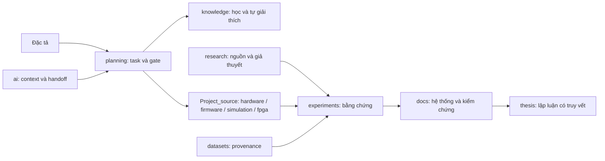

# RISC-V Ibex — Master Thesis Workspace

Workspace luận văn Kỹ thuật máy tính: học kiến trúc máy tính, triển khai SoC Ibex,
thu thập bằng chứng và viết luận văn. **Phase 1 đang khởi động; board TBD.**
Ibex là ứng viên ưu tiên. Chưa có kết quả simulation, bitstream hoặc đo FPGA.
Vivado **CONFIRMED BY USER — trên server**; cấu hình server để TBD. Bàn giao lần này là
khung workspace, chưa cài toolchain hoặc chạy build Ibex.

Kế hoạch và tiến độ được cập nhật trong **tracker Excel**; báo cáo hằng tuần cho thầy dùng
**Word**. Bạn tự cài môi trường khi bắt đầu thực hành. Engineering/source đã gom vào `Project_source/`.

Mỗi tuần: cập nhật tracker → điền báo cáo ba phần → rà soát và gửi thầy → ghi lại góp ý.

## Bản đồ workspace

| Tôi cần… | Mở ở đây |
|---|---|
| Xem kế hoạch và cập nhật tiến độ | [Project Tracker — Excel](planning/Project_Tracker_HK1_Nguyen_Hai_Minh.xlsx) |
| Báo cáo tuần cho thầy hướng dẫn | [Mẫu Word](planning/templates/Mau_bao_cao_tuan_GVHD.docx), [nháp tuần 01](planning/weekly/Bao_cao_tuan_01_2026-10-21_2026-10-27.docx) |
| Đọc đề cương nghiên cứu | [Đề cương — Word](planning/De_cuong_nghien_cuu_NguyenHaiMinh.docx) |
| Học và ghi lại điều đã hiểu | [Knowledge index](knowledge/README.md) |
| Mở sách và PDF bài báo | [Tài liệu](<Tài liệu/>); danh mục nguồn ở [Literature](research/literature/README.md) |
| Đọc paper, kiểm tra gap | [Research](research/README.md) |
| Hiểu thiết kế và giới hạn | [System context](docs/architecture/system-context.md), [Phase 1 scope](docs/design/phase1-scope.md) |
| Viết RTL / firmware | [Hardware](Project_source/hardware/README.md), [Firmware](Project_source/firmware/README.md) |
| Simulation / chạy board | [Simulation](docs/guides/simulation.md), [FPGA bring-up](docs/guides/fpga-bringup.md) |
| Kiểm tra Vivado / debug | [Vivado runbook](docs/guides/vivado-workflow.md), [Debugging](docs/guides/debugging.md) |
| Thu thập bằng chứng | [Verification matrix](docs/verification/verification-matrix.md), [Experiments](experiments/README.md) |
| Dataset / DSP tương lai | [Datasets](datasets/README.md), [DSP](Project_source/dsp/README.md) |
| Viết luận văn | [Thesis](thesis/README.md) |
| Tiếp tục bằng AI agent | [AGENTS](AGENTS.md), [current state](ai/current-state.md) |
| Công cụ / dependency khi bắt đầu triển khai | [Tools](Project_source/tools/README.md), [Upstream](Project_source/third_party/README.md) |
| Xem đã bàn giao gì | [Handoff report](WORKSPACE_HANDOFF_REPORT.md) |

## Quy trình đóng góp

Một task trong tracker → thực hiện → ghi kết quả/minh chứng → cập nhật tracker và báo cáo tuần.
Bạn tự cài môi trường; các phiên hỗ trợ tài liệu không tự chạy Make, test hoặc build.
Trạng thái test nếu có nằm ở verification matrix, không suy ra PASS từ việc tài liệu đã xong.
Commit theo `docs:`, `chore:`, `feat:`, `fix:`, `test:`; dùng branch và PR khi có remote.
Remote hiện tại: [Minhh17/HaiMinh_Master_Thesis](https://github.com/Minhh17/HaiMinh_Master_Thesis),
nhánh `main`. Chỉ push khi người dùng yêu cầu hoặc đã cho phép.

Không đưa raw radar, PDF có bản quyền, license Vivado, secrets, toolchain hoặc build outputs
vào Git. Dùng `$THESIS_DATA_ROOT` ngoài repository, manifest có checksum và backup riêng.
Chưa chọn license cho phần tự viết; không diễn giải trạng thái này thành giấy phép tái sử dụng.
Giữ nguyên license/attribution của upstream.

## Nguồn yêu cầu và upstream

[Đặc tả v1.1](IBEX_THESIS_WORKSPACE_SPEC_v1.1.md) là bản sao nguyên vẹn đầu vào.
[Ibex](https://github.com/lowRISC/ibex),
[Demo System](https://github.com/lowRISC/ibex-demo-system),
[Labs](https://github.com/lowRISC/ibex-demo-system-labs).
Revision và mức kiểm chứng được ghi trong [upstream lock](Project_source/third_party/upstream.lock.json).
