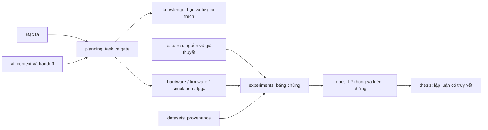

# RISC-V Ibex — Master Thesis Workspace

Workspace luận văn Kỹ thuật máy tính: học kiến trúc máy tính, triển khai SoC Ibex,
thu thập bằng chứng và viết luận văn. **Phase 1 đang khởi động; board TBD.**
Ibex là ứng viên ưu tiên. Chưa có kết quả simulation, bitstream hoặc đo FPGA.
Vivado **CONFIRMED BY USER — trên server**; cấu hình server để TBD. Bàn giao lần này là
khung workspace, chưa cài toolchain hoặc chạy build Ibex.

## Bắt đầu trong 10 phút

Chạy từ thư mục chứa README này; không chạy từ thư mục cha `Master_Thesis`.

```sh
make help
make doctor
make check
```

`make check` cần Python ≥3.8, Git và PyYAML. Nếu máy chưa có PyYAML:

```sh
python3 -m venv .venv
. .venv/bin/activate
python -m pip install -r tools/requirements-check.txt
make check
```

Việc cài package cần mạng. Các lệnh kiểm tra không tải RTL, dataset hay cài Vivado.
`make doctor` trả về 0 khi hoàn tất kiểm kê; đọc trạng thái từng công cụ, không hiểu 0 là
mọi prerequisite đã đủ. `make vivado-check`, `make sim`, `make fpga` trả về lỗi khi bị chặn.
`make sim` chỉ build firmware + simulator upstream; test chạy firmware là bước riêng.

Trong 10 phút đầu: đọc [tuần 1](planning/weekly/week-01.md), chạy ba lệnh trên,
đọc [năm việc kế tiếp](ai/next-actions.md), chọn một task trong [backlog](planning/backlog.md).
[Hướng dẫn cài đặt](docs/guides/local-setup.md) giải thích phần còn thiếu.

## Bản đồ workspace



| Tôi cần… | Mở ở đây |
|---|---|
| Biết hôm nay làm gì | [Week 1](planning/weekly/week-01.md), [next actions](ai/next-actions.md) |
| Xem kế hoạch tổng thể / Phase 1 | [Roadmap](planning/roadmap.md), [8 tuần](planning/phase1-plan.md) |
| Học và ghi lại điều đã hiểu | [Knowledge index](knowledge/README.md) |
| Đọc paper, kiểm tra gap | [Research](research/README.md) |
| Hiểu thiết kế và giới hạn | [System context](docs/architecture/system-context.md), [Phase 1 scope](docs/design/phase1-scope.md) |
| Viết RTL / firmware | [Hardware](hardware/README.md), [Firmware](firmware/README.md) |
| Simulation / chạy board | [Simulation](docs/guides/simulation.md), [FPGA bring-up](docs/guides/fpga-bringup.md) |
| Kiểm tra Vivado / debug | [Vivado runbook](docs/guides/vivado-workflow.md), [Debugging](docs/guides/debugging.md) |
| Thu thập bằng chứng | [Verification matrix](docs/verification/verification-matrix.md), [Experiments](experiments/README.md) |
| Dataset / DSP tương lai | [Datasets](datasets/README.md), [DSP](dsp/README.md) |
| Viết luận văn | [Thesis](thesis/README.md) |
| Tiếp tục bằng AI agent | [AGENTS](AGENTS.md), [current state](ai/current-state.md) |
| Kiểm tra công cụ / dependency | [Tools](tools/README.md), [Upstream](third_party/README.md) |
| Xem đã bàn giao gì | [Handoff report](WORKSPACE_HANDOFF_REPORT.md) |

## Quy trình đóng góp

Một task có ID → ghi yêu cầu/ADR → thay đổi nhỏ → `make check` → bằng chứng kiểm thử
→ cập nhật backlog và AI handoff. Trạng thái task nằm ở backlog; trạng thái test nằm ở
verification matrix, không suy ra test PASS từ việc task tài liệu đã xong.
Commit theo `docs:`, `chore:`, `feat:`, `fix:`, `test:`; dùng branch và PR khi có remote.
Repository này hiện chỉ ở local. Chỉ tạo/push remote sau khi người dùng duyệt; ưu tiên private.

Không đưa raw radar, PDF có bản quyền, license Vivado, secrets, toolchain hoặc build outputs
vào Git. Dùng `$THESIS_DATA_ROOT` ngoài repository, manifest có checksum và backup riêng.
Chưa chọn license cho phần tự viết; không diễn giải trạng thái này thành giấy phép tái sử dụng.
Giữ nguyên license/attribution của upstream.

## Nguồn yêu cầu và upstream

[Đặc tả v1.1](IBEX_THESIS_WORKSPACE_SPEC_v1.1.md) là bản sao nguyên vẹn đầu vào.
[Ibex](https://github.com/lowRISC/ibex),
[Demo System](https://github.com/lowRISC/ibex-demo-system),
[Labs](https://github.com/lowRISC/ibex-demo-system-labs).
Revision và mức kiểm chứng được ghi trong [upstream lock](third_party/upstream.lock.json).
