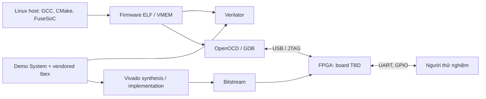
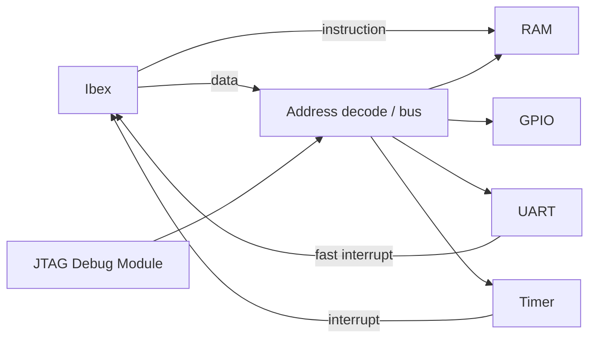

# Bối cảnh hệ thống Phase 1

Trạng thái: **thiết kế tham chiếu đã đọc; triển khai tại workspace NOT RUN**.
CPU ưu tiên là Ibex, SoC tham chiếu là Ibex Demo System theo
[dependency lock](../../third_party/upstream.lock.json). FPGA vẫn TBD.

Trong demo, Ibex có đường instruction và data riêng. Instruction fetch đọc RAM
hoặc vùng debug; data cùng debug host qua bus decode tới RAM và MMIO. RAM chứa
chương trình và dữ liệu; UART/GPIO/timer là ngoại vi của SoC, không phải một phần ISA.
JTAG debug có thể dừng CPU và truy cập hệ thống. Timer nối `irq_timer_i`; UART nối
bit thấp của `irq_fast_i`. Không mặc định gọi bus này là AXI hay Wishbone.

Thông số source và memory map ở [design/memory-map.md](../design/memory-map.md).
Clock parameter mặc định của module không chứng minh clock sau triển khai hay
tần số đạt timing. Kết quả simulator đo hành vi mô hình; timing Vivado và đo UART
trên board là bằng chứng riêng.

Nguồn: [RTL demo cố định](https://github.com/lowRISC/ibex-demo-system/blob/d37beb753e19482eb054aefac73a27289bf72e47/rtl/system/ibex_demo_system.sv),
[Ibex instruction interface tại pin](https://github.com/lowRISC/ibex/blob/594ea976c9dad793f87edf91ec1c4c1df447e6dc/doc/03_reference/instruction_fetch.rst).
