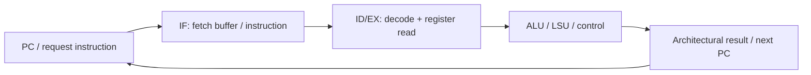

# CA01–CA03: RV32I và fetch/decode/execute của Ibex

**SOURCED DRAFT — AI hỗ trợ, chưa được người học kiểm chứng.** Ngày nguồn được mở: 2026-10-23. Task: P1-05/P1-07. Bài tập tay chưa chạy trên simulator; không có kết quả performance. Tài liệu Ibex `latest` phải đối chiếu với revision/configuration sẽ pin.

## Hai tầng cần phân biệt

RV32I quy định 32 thanh ghi nguyên 32-bit; `x0` luôn bằng 0. `pc` giữ địa chỉ lệnh. `ADDI` cộng immediate với thanh ghi nguồn, giữ 32 bit thấp; ISA mô tả hiệu ứng kiến trúc, không ấn định số pipeline stage. [RISC-V RV32I, programmer model và ADDI](https://docs.riscv.org/reference/isa/v20260120/unpriv/rv32.html).

Ibex mặc định có IF và ID/EX; đọc/ghi register diễn ra ở ID/EX. Có cấu hình thêm writeback stage. Vì vậy sơ đồ 5 stage trong một bài giảng chỉ là mô hình để so sánh, không tự động mô tả cấu hình Ibex đang dùng. [Ibex pipeline details](https://ibex-core.readthedocs.io/en/latest/03_reference/pipeline_details.html).



Sơ đồ là giải thích luồng thông tin, **không** biểu diễn mỗi ô thành một pipeline stage hoặc một cycle. Khi phân tích implementation phải đặt tên tín hiệu thật từ RTL đã pin bên cạnh từng mũi tên.

IF dùng prefetch buffer nếu không cấu hình instruction cache. Compressed instructions được mở rộng tại IF trước decode. Giao tiếp fetch phân biệt request `instr_req_o`, chấp nhận `instr_gnt_i` và dữ liệu trả về `instr_rvalid_i`; request phải giữ tới grant. [Ibex Instruction Fetch](https://ibex-core.readthedocs.io/en/latest/03_reference/instruction_fetch.html).

## Bài tập tay có lời giải kiểm tra

Giả sử ba lệnh 32-bit liên tiếp sau bắt đầu ở địa chỉ tượng trưng `P`, không exception và không có tác động ngoài. Đây là ví dụ tự soạn, chưa phải firmware của demo:

```asm
addi x5, x0, 7
addi x6, x5, -2
add  x7, x5, x6
```

Dự đoán sau từng lệnh: `x5 = 7`, `x6 = 5`, `x7 = 12`; PC tuần tự sau ba lệnh là `P + 12`. Hãy tự chỉ ra `rs1`, `rs2`/immediate, `rd` và vị trí dữ liệu vào ALU. Đáp số này là suy luận từ semantics, **không** phải kết quả chạy. Dựa trên phép ADD/ADDI và định dạng base 32-bit trong [RV32I](https://docs.riscv.org/reference/isa/v20260120/unpriv/rv32.html).

Sau khi simulator dùng được, thêm bài kiểm tra nhỏ theo flow upstream, lấy disassembly để chắc compiler/assembler không thay chuỗi bằng dạng compressed. Ghi cấu hình ISA và bằng chứng thật trước khi so thời gian với dự đoán.

## Những câu hỏi phải tự trả lời

1. Tại sao cùng hiệu ứng register cuối cùng có thể xuất hiện với nhiều timing khác nhau?
2. Khi grant chậm, đâu là request còn đang chờ và đâu là response chưa về?
3. Nếu bật C, vì sao không thể áp dụng quy tắc `PC + 4` cho mọi lệnh của chương trình?
4. Cấu hình dùng trong simulator bật writeback/cache nào? Tìm ở file cấu hình, không đoán từ tên core.

Quan sát cần có cho P1-07: một đoạn waveform có PC, request/grant/response và chú thích chu kỳ chờ; ghi tách latency một lệnh và throughput chuỗi lệnh. Chưa thể suy CPI thực hay fmax chỉ từ note này. Người học review: **chưa ghi nhận**.
