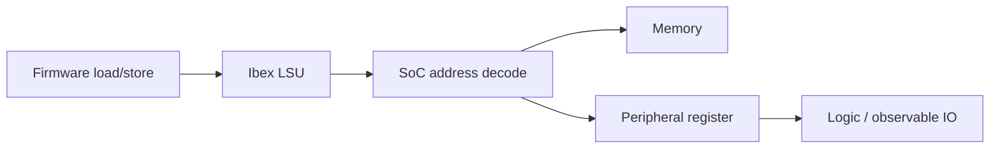

# CA03/CA05: MMIO và cách dựng memory map có bằng chứng

**SOURCED DRAFT — AI hỗ trợ, chưa được người học kiểm chứng.** Nguồn mở ngày 2026-10-23. Task: P1-06/P1-11. Không có địa chỉ ngoại vi nào dưới đây được tuyên bố là map của board; RTL/simulation/hardware test: **NOT RUN**.

## Từ địa chỉ của chương trình tới ngoại vi

Trong RV32I, load/store truy cập bộ nhớ, còn arithmetic thao tác trên register. Vùng địa chỉ hợp lệ và kiểu truy cập được môi trường thực thi xác định. Vì vậy ISA không cho biết địa chỉ UART của SoC cụ thể. [RISC-V RV32I, load/store](https://docs.riscv.org/reference/isa/v20260120/unpriv/rv32.html).

MMIO là cách một vùng địa chỉ được SoC giải mã tới thanh ghi ngoại vi. Câu hỏi thực hành không chỉ là “base bao nhiêu?”, mà còn “read/write có tác động gì?”. Demo System có UART, GPIO và timer; phải truy wiring/register implementation ở **SHA được pin**, không mang địa chỉ từ một SoC khác sang. [Upstream Demo System](https://github.com/lowRISC/ibex-demo-system).

Đây là luồng khái niệm, chưa là sơ đồ interconnect chính thức của workspace. Một test tốt phải chứng minh các mối nối của đường đi này từ source hoặc observation.

LSU đặt `data_req_o`, địa chỉ và thông tin read/write; `data_gnt_i` đánh dấu request được nhận. Response đến với `data_rvalid_i`, dữ liệu và lỗi. Grant và response là hai sự kiện riêng; store cũng cần response. [Ibex LSU protocol](https://ibex-core.readthedocs.io/en/latest/03_reference/load_store_unit.html).

## Bảng phải điền từ source thật

| Trường | Evidence cần tìm |
| --- | --- |
| Base và kích thước vùng | Decoder/top-level cùng SHA, symbol và file:line |
| Offset register | RTL/register description, đối chiếu firmware header |
| Access width/alignment | Logic byte enable và driver dùng đúng kiểu truy cập |
| Read/write semantics | RO/RW/write-one-to-clear/read-clear nếu source định nghĩa; không tự suy |
| Reset value | Reset branch của register và reset được áp dụng trong test |
| Side effect | Điều kiện phát tx, clear interrupt hoặc đổi GPIO; expected/actual |
| Linker region | Code/data có đặt đúng memory, không chồng peripheral window |

**Bài tập:** chọn đúng một GPIO output register sau P1-03, điền bảng trên, ghi chuỗi `base + offset → decoded slave → register → output`. Chạy một pattern có thể quan sát khi board sẵn sàng; trước đó có thể chuẩn bị test trong simulator nếu peripheral được mô hình hóa. Kết quả chưa chạy giữ NOT RUN.

## Điểm dễ hiểu nhầm trong C

`volatile` thường dùng để biểu thị truy cập hardware, nhưng không phải memory barrier sắp thứ tự mọi truy cập RAM. Không dùng một volatile register write để mặc định chứng minh mọi non-volatile data đã được ghi trước. [GCC: When is a Volatile Object Accessed?](https://gcc.gnu.org/onlinedocs/gcc/Volatiles.html).

Ví dụ ý tưởng (không phải driver có thể chạy): `write32(BASE + OFFSET, pattern)`. `BASE`, `OFFSET`, access width và semantics phải lấy từ bảng đã kiểm chứng; ưu tiên API driver upstream. Trước phép read-modify-write, kiểm tra register có side effect hay write-one-to-clear không. Chưa có định nghĩa register thì chưa viết routine cập nhật bit “dùng chung”.

Tự kiểm chứng: giải thích vì sao cùng lệnh `sw` có thể ghi RAM hoặc tác động peripheral; chỉ ra evidence cho địa chỉ và side effect đã chọn. Người học review: **chưa ghi nhận**.
