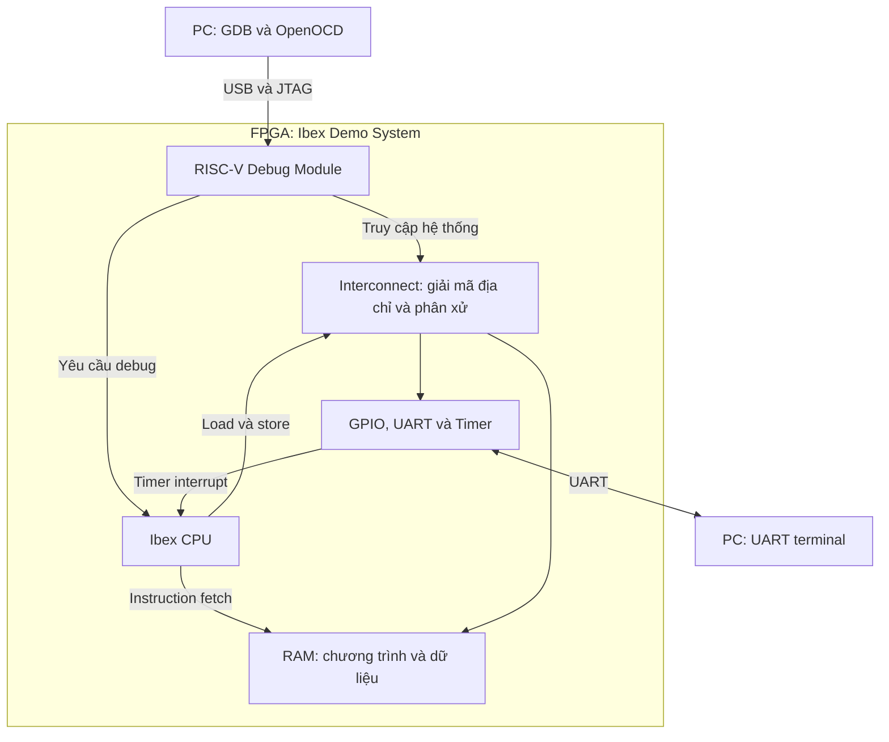

# Phase 1 — Ibex RISC-V SoC: khảo sát nền tảng và kế hoạch tuần 1

Nguyễn Hải Minh · Luận văn thạc sĩ Kỹ thuật máy tính, HUST  
Ngày khảo sát: 21/10/2026 · Tuần 1: 21–27/10/2026  
Phạm vi: WP1 + phần khởi đầu WP2/WP3. Accelerator chưa nằm trong phần triển khai.

## 1. Quyết định làm việc

Khởi đầu bằng Ibex Demo System nguyên bản, chạy firmware mẫu trong RTL simulation, sau đó triển khai lên board được chọn. Giữ cấu hình của Demo System cho lần chạy đầu tiên để có điểm đối chiếu với upstream. Board là quyết định có điều kiện, cần thông tin về thiết bị sẵn có, ngân sách và kết quả build.

Đây là bản khảo sát tài liệu và mã nguồn, cùng kế hoạch thực hiện. Chưa chạy build firmware, Verilator, Vivado hoặc thử nghiệm FPGA trên máy của Minh; mọi hạng mục thực nghiệm ở trạng thái **NOT RUN**.

| Nội dung | Trạng thái | Căn cứ hoặc việc còn thiếu |
|---|---|---|
| Ibex là core ưu tiên | Quyết định Phase 1 | Phù hợp mục tiêu học và xây SoC nhỏ |
| Ibex Demo System làm hệ thống tham chiếu | Đề xuất thực hiện | Có luồng mô phỏng, FPGA và debug [S1] |
| Đặc tính cấu hình Demo System | Đã đối chiếu nguồn | SoC RTL, CPU vendored và wrapper [S3–S6] |
| FPGA board cuối cùng | Chưa chốt | Thiết bị sẵn có, báo giá, thời gian mua/mượn và build |
| Tài nguyên và timing của thiết kế | Chưa đo | Cần synthesis/implementation theo đúng part |
| Bộ công cụ tương thích trên máy Minh | Chưa kiểm chứng | Cần kiểm kê và chạy smoke test |

## 2. Phiên bản tham chiếu

- Repository: https://github.com/lowRISC/ibex-demo-system
- Commit nhánh `main` được xác nhận trong lần khảo sát: `d37beb753e19482eb054aefac73a27289bf72e47`.
- Lock file ghi upstream Ibex revision: `594ea976c9dad793f87edf91ec1c4c1df447e6dc`.
- Nguồn CPU dùng để đối chiếu là bản trong `vendor/lowrisc_ibex` của Demo System. Lock file không thay thế việc giữ nguyên các patch và toàn bộ cây vendor.

Commit này là **ứng viên để bắt đầu smoke test**, chưa phải một phiên bản đã được chứng nhận chạy đúng trên môi trường của Minh. Nếu phải chọn commit khác để xử lý lỗi, ghi lý do và pin lại nguồn.

Không thay riêng CPU vendored bằng Ibex `master` trong lần bring-up đầu tiên. Tài liệu `latest` có thể mô tả tham số hoặc extension mới hơn bản CPU đã đi kèm Demo System.

Một SHA cho Demo System vẫn chưa đủ để tái lập đầy đủ: `python-requirements.txt` sử dụng nhánh `ot` của hai fork lowRISC FuseSoC/Edalize [S7]. Sau lần cài thành công, lưu cả revision thực tế của chúng và danh sách package. Container cũng cần ghi digest nếu dùng làm môi trường tái lập.

## 3. Bốn lớp cần phân biệt

| Lớp | Câu hỏi nó trả lời | Trong dự án này |
|---|---|---|
| ISA | Phần mềm được phép yêu cầu CPU làm gì? | RISC-V RV32I, M, C và các chức năng hệ thống cần dùng |
| Microarchitecture | Phần cứng thực hiện ISA ra sao? | Pipeline, ALU, register file, LSU, bộ nhân/chia của Ibex |
| SoC | CPU kết nối với bộ nhớ, ngoại vi và debug như thế nào? | Ibex Demo System |
| FPGA implementation | RTL được ánh xạ lên phần cứng vật lý nào? | LUT, FF, BRAM, clock resources, pins của board |

Hai CPU có cùng ISA vẫn có thể khác số tầng pipeline, số chu kỳ phép nhân và hiệu năng. Cùng một CPU RTL cũng có thể dùng tài nguyên khác nhau khi đổi cấu hình, FPGA hoặc thiết lập synthesis.

Firmware C là phần mềm mà CPU sẽ thực thi. Bitstream cấu hình FPGA để tạo ra CPU cùng phần cứng SoC. Thay firmware thường không cần tổng hợp lại toàn bộ phần cứng nếu đã có đường nạp vào RAM; thay RTL thì cần build lại phần cứng.

## 4. Cấu trúc và luồng hoạt động

Sơ đồ dưới đây thể hiện các quan hệ chính. Nó không mô tả toàn bộ tín hiệu và arbitration.



CPU có đường truy cập lệnh và đường truy cập dữ liệu riêng. Trong Demo System, RAM hai cổng chứa cả code và data; đường fetch không đơn giản đi chung toàn bộ với đường MMIO. Debug Module còn có khả năng làm bus host. Các chi tiết này cần được giữ trong sơ đồ kiến trúc tự vẽ [S3].

### 4.1 Từ reset tới hàm `main`

1. RAM phải được nạp nội dung hợp lệ bằng cơ chế phù hợp với simulation hoặc FPGA.
2. Sau reset, CPU bắt đầu lấy lệnh ở reset vector được cấu hình.
3. Startup assembly chuẩn bị môi trường chạy C, gồm stack và khởi tạo vùng BSS.
4. Startup chuyển điều khiển vào `main`.
5. Chương trình dùng lệnh load/store để đọc dữ liệu và truy cập ngoại vi.

Trong bộ nguồn tham chiếu, `boot_addr_i = 0x00100000`; reset vector nằm tại base + `0x80`, tương ứng `0x00100080`. Khi thực hành, phải đối chiếu địa chỉ này trong linker script, ELF và waveform, thay vì suy ra entry point là đầu vùng RAM [S3, S13, S14].

Ở đây code và dữ liệu được nạp vào RAM. Không mặc định rằng startup phải copy `.data` từ flash như một hệ MCU khác; cần đọc đúng startup đang sử dụng.

### 4.2 Một lệnh cộng và một lệnh ghi bộ nhớ

Ví dụ để học, giả sử `a0` đã chứa địa chỉ RAM hợp lệ:

```asm
addi t0, x0, 5
addi t1, x0, 7
add  t2, t0, t1
sw   t2, 0(a0)
```

Lệnh `add` đọc hai thanh ghi nguồn, ALU tính tổng và ghi kết quả vào thanh ghi đích. Lệnh `sw` dùng LSU để gửi yêu cầu ghi giá trị 12 tới bộ nhớ. Đây là hai loại hoạt động khác nhau: tính toán trên thanh ghi và giao dịch với hệ thống bộ nhớ.

Khi quan sát chương trình C, dùng disassembly làm cầu nối với waveform. Compiler có thể gộp hoặc loại bỏ phép tính hằng; một dòng C không tương ứng cố định với một lệnh máy. Khi bật C extension, địa chỉ lệnh kế tiếp cũng có thể tăng 2 byte, không luôn tăng 4 byte.

### 4.3 GPIO hoạt động qua MMIO

MMIO dành một số địa chỉ cho thanh ghi phần cứng. Một store vào vùng GPIO khiến mạch giải mã địa chỉ chọn GPIO và cập nhật thanh ghi output. Store vào vùng RAM cập nhật ô nhớ. CPU dùng cùng họ lệnh load/store nhưng phần cứng đích khác nhau.

Khi viết C cho MMIO, dùng driver/header đã có và hiểu vai trò của `volatile`. `volatile` liên quan cách compiler xử lý truy cập; nó không tự tạo bus protocol hoặc thay thế mọi yêu cầu về ordering.

### 4.4 Timer và debug là hai đường điều khiển khác nhau

Timer interrupt yêu cầu CPU xử lý trap theo cơ chế kiến trúc: phần mềm phải cấu hình nguồn ngắt, CSR enable và handler. Debug Module cho phép công cụ bên ngoài yêu cầu CPU vào debug để halt, step hoặc đọc trạng thái. Một cổng USB/JTAG có thể phục vụ nạp FPGA và truy cập CPU qua logic trung gian, nhưng nạp bitstream thành công chưa chứng minh GDB đã điều khiển được CPU.

Tuần 1 chỉ cần giải thích được hai luồng này. Bài thực hành interrupt và hardware debug đầy đủ vẫn ở các tuần sau.

## 5. Memory map ban đầu

Các địa chỉ sau được lấy từ SoC RTL của commit tham chiếu [S3]. Đây là vùng địa chỉ được giải mã, không phải dung lượng thanh ghi hữu ích của từng ngoại vi.

| Khối | Base address | Kích thước vùng |
|---|---|---:|
| RAM | `0x00100000` | 128 KiB |
| Debug | `0x1A110000` | 64 KiB |
| GPIO | `0x80000000` | 4 KiB |
| UART | `0x80001000` | 4 KiB |
| Timer | `0x80002000` | 4 KiB |
| PWM | `0x80003000` | 4 KiB |
| SPI | `0x80004000` | 1 KiB |
| Simulation control | `0x00020000` | 1 KiB |

Simulation control là một tiện ích của môi trường mô phỏng; không dùng việc nó in text hoặc kết thúc simulation để kết luận UART vật lý đã hoạt động.

Bài đọc nguồn hữu ích: `sw/common/link.ld` có một số comment kích thước không khớp literal. `0x1E000` bằng **120 KiB**, `0x02000` bằng **8 KiB**, dù comment ghi 124/4 KiB. Tổng hai vùng vẫn là 128 KiB. Khi lập báo cáo, ưu tiên giá trị thực, kiểm tra ELF/link map và ghi rõ sai lệch comment [S14].

## 6. Pipeline và cấu hình Ibex

Pipeline hai tầng gồm IF và ID/EX. IF lấy lệnh; ID/EX giải mã và thực hiện lệnh, gồm các hoạt động cần thiết với register file. Tùy cấu hình có thể thêm Writeback stage. Không áp sơ đồ năm tầng trong giáo trình vào Ibex [S8].

Latency của một lệnh khác throughput của cả pipeline. Hai tầng không có nghĩa mọi chương trình đều cần hai chu kỳ cho mỗi lệnh; cũng không bảo đảm CPI bằng 1. Fetch, load/store, branch và các lệnh nhiều chu kỳ tạo ra chờ.

| Phương án | Đặc tính liên quan | Lựa chọn cho Phase 1 |
|---|---|---|
| Demo System nguyên bản | Hai tầng, `RV32MFast`, không I-cache; có cấu hình debug/HPM ở SoC | **Dùng cho bring-up đầu tiên** |
| Named config `small` | Hai tầng, multiplier 3 chu kỳ cho MUL; tập tham số tối giản hơn | Tham chiếu để hiểu đánh đổi |
| Named config `maxperf` | Ba tầng, multiplier single-cycle và branch-target ALU | Đánh giá sau khi baseline chạy ổn |
| `maxperf-pmp-bmbalanced` | Thêm PMP và bit manipulation | Chỉ cần nếu bài toán thực sự đòi hỏi |
| `opentitan` | Nhiều tính năng bảo vệ, cache và bảo mật | Không cần đưa vào baseline học ban đầu |

Tên cấu hình là một tập tham số cụ thể, không phải nhãn mô tả chung. Demo System không mặc nhiên áp nguyên bộ `small` chỉ vì cùng pipeline hai tầng [S9].

Các tham số đã đối chiếu cho bản tham chiếu [S3–S6]:

| Tham số hoặc thuộc tính | Giá trị hiệu lực cần ghi |
|---|---|
| Base integer registers | `RV32E = 0` |
| Multiplier/divider | `RV32MFast` |
| Bit manipulation | `RV32BNone` |
| Writeback stage | `0`, kế thừa default của CPU vendored |
| Branch-target ALU / predictor | `0 / 0`, kế thừa default |
| Instruction cache | `0`, kế thừa default |
| SecureIbex / PMP | `0 / 0`, kế thừa default |
| HPM event counters | `MHPMCounterNum = 10`, do SoC đặt |
| Register file trong simulation | `RegFileFF`, wrapper mô phỏng đặt |
| Register file trên Arty A7 | `RegFileFPGA`, wrapper FPGA kế thừa default SoC |

`RegFileFPGA` hướng đến distributed RAM trên FPGA; nó không có nghĩa 32 thanh ghi CPU trở thành vùng program BRAM. Tài liệu giải thích lựa chọn register file theo công nghệ triển khai [S10]. Sự khác nhau FF/FPGA giữa hai target phải có trong manifest; nó không tự làm kết quả chức năng không tương đương, nhưng cần biết khi đọc hierarchy và kiểm tra timing.

Các thanh ghi `mcycle` và `minstret` là nền tảng đo cycle count và retired instructions. HPM bổ sung phụ thuộc cấu hình. Trước khi đo ở tuần 7, cần kiểm tra enable, counter width và cách đọc counter 64-bit trên RV32 [S11].

## 7. Chọn FPGA theo board cụ thể

Artix-7, Spartan-7 và Zynq-7000 là họ thiết bị. Công sức bring-up phụ thuộc cả board, revision, FPGA part/package/speed grade, clock, pin mapping, USB bridge và debug transport.

### 7.1 So sánh tài nguyên và hỗ trợ

Tài nguyên trong bảng là **tổng tài nguyên thiết bị**, chưa phải utilization của Ibex. BRAM36 là số block 36 Kibit, gồm cả bit parity theo cấu trúc phần cứng [S17]. Trạng thái target lấy từ README và `.core` [S1, S2].

| Board | FPGA | LUT | FF | BRAM36 | DSP | Hỗ trợ Demo System và nhận định |
|---|---|---:|---:|---:|---:|---|
| Arty A7-35T | XC7A35T | 20,800 | 41,600 | 50 | 90 | Good support; target `synth`; tốt nếu mượn được |
| Sonata | XC7A50T | 32,600 | 65,200 | 75 | 120 | Good support; `synth_sonata`; cần xác nhận nguồn cung |
| Arty S7-25 | XC7S25 | 14,600 | 29,200 | 45 | 80 | Community/experimental; `synth_artys7-25`; ít dư địa bộ nhớ hơn |
| Arty S7-50 | XC7S50 | 32,600 | 65,200 | 75 | 120 | Community/experimental; `synth_artys7-50`; ứng viên nếu cần kiểm soát chi phí |
| Nexys A7-100T | XC7A100T | 63,400 | 126,800 | 135 | 240 | Community/experimental; `synth_nexysa7`; nhiều dư địa |
| Arty A7-100T | XC7A100T | 63,400 | 126,800 | 135 | 240 | Không có target riêng trong `.core` đang khảo sát; cần kiểm tra/điều chỉnh part và debug |
| Zynq-7000 có sẵn | Chưa có model | — | — | — | — | Chỉ đánh giá được sau khi biết board cụ thể |

**Arty A7-35T đã được Digilent ghi là ngừng sản xuất/retired** [S15]. Đây vẫn là ứng viên thực hành tốt nếu đã có hoặc mượn được, nhưng không nên dùng làm mặc định cho quyết định mua mới.

Arty S7-50 và Sonata cùng số LUT/FF/BRAM/DSP trong bảng; điều đó không chứng minh chúng có cùng timing, I/O hay trải nghiệm bring-up. Không suy thứ hạng hiệu năng từ tên họ FPGA hoặc số logic cells.

Với Zynq, Ibex có thể nằm trong programmable logic; CPU ARM trong PS không phải điều kiện bắt buộc cho bài thực hành Ibex. Tuy nhiên, clock/reset và đường UART/JTAG phụ thuộc board. Ví dụ README ghi Blackboard đưa UART của thiết kế ra PMOD vì cổng serial trên board đi vào PS [S1]. Không khái quát điều đó cho mọi Zynq board.

DDR trên board chỉ trở thành bộ nhớ CPU dùng được khi đã tích hợp controller, interconnect, address map và firmware tương ứng. Baseline này dùng RAM nội FPGA; không tính dung lượng DDR vào dung lượng RAM sẵn dùng của Ibex.

### 7.2 Quy tắc ra quyết định

Kiểm tra các điều kiện bắt buộc trước khi chấm điểm:

1. Có thể sử dụng board đủ sớm để không chặn FPGA bring-up.
2. Vivado đang có hỗ trợ đúng part; có schematic/XDC phù hợp revision.
3. Có đường nạp bitstream, UART và debug CPU khả thi.
4. Kết quả implementation cho thấy đủ tài nguyên, constraints hợp lệ và timing đạt ở clock mục tiêu.
5. Tổng chi phí gồm board, nguồn, cáp, adapter cần thiết và thời gian port nằm trong khả năng thực hiện.

Sau đó mới so sánh ứng viên theo mức hỗ trợ upstream, khả năng tiếp cận, dư địa LUT/BRAM/DSP và tổng chi phí. Nếu dùng trọng số, phải ghi rõ đây là ưu tiên của dự án, không phải số đo khoa học khách quan.

Đề xuất có điều kiện:

- Có Arty A7-35T hoặc Sonata dùng được: ưu tiên kiểm chứng một trong hai trước.
- Phải mua và ngân sách hạn chế: khảo sát Arty S7-50, kèm thời gian xử lý target cộng đồng.
- Cần giữ nhiều dư địa cho giai đoạn sau và ngân sách cho phép: khảo sát Nexys A7-100T.
- Đã có Zynq: xác định model trước; tái sử dụng có thể tốt hơn mua board khác, nhưng cần lượng hóa công port.

Chưa có thông tin đủ để kết luận board cuối cùng hoặc ước lượng giá giao tới Minh. Không cần chứng minh một board là tốt nhất trong mọi FPGA; cần chứng minh nó đáp ứng các ràng buộc thí nghiệm của luận văn.

## 8. Kiến thức Computer Architecture học ngay tuần 1

| Chủ đề | Kiến thức cần nắm | Thực hành và bằng chứng |
|---|---|---|
| ISA, CPU, SoC | Phân biệt hợp đồng phần mềm, cách hiện thực và hệ thống | Tự giải thích bốn lớp ở mục 3 |
| RV32I và register file | `x0–x31`, PC, source/destination, immediate; ABI `sp`, `ra`, `a0` | Giải thích 8–10 lệnh từ disassembly [S12] |
| Load/store và địa chỉ | Byte address, word 32-bit, offset, alignment, little endian | Theo dõi một load và một store |
| M và C extensions | Nhân/chia integer; lệnh nén; ISA khác latency phần cứng | Tìm MUL và lệnh 16-bit nếu binary có |
| Datapath và pipeline | IF, ID/EX, ALU, register write; latency/CPI/stall | Vẽ luồng lệnh cộng và chỉ điểm chờ [S8] |
| Giao diện bộ nhớ | Request, grant, response; byte enable | Chỉ ra `req`, `gnt`, `rvalid`, `addr`, `we`, `be`, `wdata`, `rdata` [S18] |
| Toolchain và boot | Compiler/assembler/linker; ELF; startup; `.text/.data/.bss`; stack | Đối chiếu reset vector, linker và ELF [S13, S14] |
| Bus và MMIO | Decode địa chỉ; peripheral registers | Chỉ đường store tới GPIO trong RTL |

Interrupt/CSR, hardware debug và performance counters: đọc sơ đồ tổng quan tuần 1, học sâu khi đến phần thực hành tương ứng. Cache hierarchy lớn, out-of-order, coherence, virtual memory và RTOS chưa phải điều kiện để bắt đầu.

Giáo trình chính có thể dùng *Computer Organization and Design — RISC-V Edition*. Tuần 1 ưu tiên phần ISA và datapath/pipeline cơ bản; không đặt mục tiêu đọc hết các chương bộ nhớ và hiệu năng. Dùng tài liệu Ibex để kiểm tra khái niệm xuất hiện ở đâu trong RTL.

## 9. Kế hoạch 21–27/10/2026

Giả định có khoảng **15–16 giờ trong tuần**. Đây là ngân sách để lập kế hoạch, chưa phải thời gian Minh đã cam kết. Nếu chỉ có 8–10 giờ, ưu tiên kiến thức cốt lõi, firmware build và một simulation; chuyển khảo sát cấu hình mở rộng sang W2.

| Ngày | Thời lượng | Mục tiêu và tài liệu | Bài thực hành | Kết quả/tiêu chí |
|---|---:|---|---|---|
| 21/10 | 2 giờ | Phân biệt ISA/core/SoC/FPGA; đọc [S1], [S2] | Kiểm kê máy, board có thể mượn; vẽ sơ đồ hệ thống | `D1.1-draft`: giải thích đúng vai trò của từng khối |
| 22/10 | 2 giờ | RV32I, register/PC, ABI cơ bản [S12] | Giải thích đoạn assembly ngắn; disassemble một hàm C nếu compiler sẵn có | `CA01`: 8–10 lệnh có chú thích; hiểu load/store |
| 23/10 | 2 giờ | Pipeline, fetch, LSU [S8], [S18] | Lần `ibex_demo_system` → `ibex_top`; lập memory map; mô tả handshake | `CA02`: đường lệnh và dữ liệu, phân biệt grant/response |
| 24/10 | 2–3 giờ | Môi trường build và ELF [S7], [S13], [S14] | Pin commit, tạo venv, cài dependency, build firmware mẫu | Có ELF RV32 phù hợp, lưu build log và versions |
| 25/10 | 3 giờ | Verilator và waveform [S19] | Build simulator, nạp ELF, tạo trace; sửa thông điệp trong firmware và chạy lại | Có bằng chứng binary mới đã được thực thi; trace có fetch và giao dịch dữ liệu |
| 26/10 | 2 giờ | Board, tài nguyên và target [S2], [S15–S17] | So sánh 2–3 board thực sự tiếp cận được; kiểm tra nguồn/cáp/debug | `D1.2-draft`: ứng viên chính/dự phòng hoặc ghi rõ dữ liệu còn thiếu |
| 27/10 | 2 giờ | Tổng hợp và tự giải thích | Tái chạy từ hướng dẫn; cập nhật sơ đồ/manifest; trả lời câu hỏi nghiệm thu | `D1.3-draft`, `D2.1-week1`, log simulation và kế hoạch W2 |

Nếu tới 24–25/10 gặp lỗi công cụ, giữ nguyên lỗi đầu tiên, lệnh và phiên bản để xử lý có căn cứ. Không nâng đồng loạt toàn bộ toolchain trong lúc chưa biết nguyên nhân. Timebox khoảng 2 giờ cho một hướng xử lý trước khi xem lại giả thuyết; không dùng timebox để tự coi test là PASS.

## 10. Luồng thao tác dự kiến

Các lệnh dưới đây là hướng dẫn theo nguồn đã khảo sát, **chưa chạy trên máy Minh**. Bắt đầu trong thư mục làm việc mới để giữ tách biệt các project sẵn có.

### 10.1 Kiểm kê môi trường

Ghi OS, CPU architecture, dung lượng RAM/đĩa và kết quả của các công cụ có sẵn:

```bash
uname -a
cat /etc/os-release
python3 --version
git --version
cmake --version
g++ --version
verilator --version
riscv32-unknown-elf-gcc --version
openocd --version
vivado -version
```

Công cụ chưa cài được ghi `MISSING`; không cần cài toàn bộ OpenOCD/Vivado chỉ để bắt đầu đọc kiến trúc hoặc mô phỏng.

Nếu build trên server và board cắm ở máy khác, ghi rõ nơi chạy Vivado, nơi nạp bitstream và nơi chạy OpenOCD/UART. Sức mạnh của máy build không thay thế quyền truy cập USB vật lý.

### 10.2 Lấy nguồn và cài Python dependency

```bash
git clone https://github.com/lowRISC/ibex-demo-system.git
cd ibex-demo-system
git checkout --detach d37beb753e19482eb054aefac73a27289bf72e47
git rev-parse HEAD
python3 -m venv .venv
source .venv/bin/activate
python3 -m pip install -r python-requirements.txt
```

Không thay fork FuseSoC/Edalize bằng bản PyPI tùy ý. Sau khi chạy thành công, ghi kết quả `python3 -m pip freeze --all` vào manifest để lưu revision đã được giải quyết từ nhánh `ot`.

Container tại commit tham chiếu khai báo Verilator `4.210`, lowRISC toolchain tag `20220210-1` và OpenOCD `v0.12.0` [S20]. Đây là bằng chứng về bộ công cụ upstream chọn, không phải khẳng định container hoặc các binary cũ chắc chắn chạy trên host của Minh. README đưa một ví dụ toolchain khác và yêu cầu OpenOCD từ 0.12.0 [S1].

Ưu tiên dùng môi trường hiện có rồi kiểm chứng. Nếu cần môi trường thay thế, chọn một bộ công cụ nhất quán và ghi phiên bản, thay vì mặc định bản mới nhất của từng thành phần sẽ tương thích.

### 10.3 Build firmware C

```bash
cmake -S sw/c -B sw/c/build
cmake --build sw/c/build
riscv32-unknown-elf-readelf -h sw/c/build/demo/hello_world/demo
riscv32-unknown-elf-readelf -l sw/c/build/demo/hello_world/demo
riscv32-unknown-elf-objdump -d sw/c/build/demo/hello_world/demo
```

Kiểm tra đây là ELF 32-bit cho RISC-V, entry point và load segments phù hợp vùng RAM. `gcc_toolchain.cmake` đang dùng executable prefix `riscv32-unknown-elf-`, ISA `rv32imc` và ABI `ilp32` [S21].

Một compiler tên `riscv64-unknown-elf-gcc` có thể hỗ trợ RV32 nếu được build đúng multilib; tên executable tự nó không chứng minh hoặc phủ định điều đó. Cần kiểm tra `-print-multi-lib`, thư viện, ABI và cấu hình CMake. Không giải quyết bằng đổi tên executable đơn thuần.

Nếu compiler mới báo CSR hoặc `fence.i` cần extension riêng, kiểm tra cách phiên bản đó xử lý `Zicsr/Zifencei` trước khi chỉnh ISA flags. Ghi patch và lý do; không bật extension chỉ để bỏ lỗi khi chưa đối chiếu RTL.

### 10.4 Build và chạy RTL simulation

```bash
fusesoc --cores-root=. run --target=sim --tool=verilator --setup --build lowrisc:ibex:demo_system
./build/lowrisc_ibex_demo_system_0/sim-verilator/Vtop_verilator -t --meminit=ram,./sw/c/build/demo/hello_world/demo
```

Lab 2 cũ sử dụng tên executable `Vibex_demo_system` và thư mục firmware `sw/build/...`; nguồn/README đang khảo sát dùng `Vtop_verilator` và `sw/c/build/...` [S1, S19]. Theo log build thực tế của commit đã pin.

Mở trace FST bằng GTKWave. Xác định clock/reset, địa chỉ fetch, load/store và response. Chọn một đoạn ngắn để giải thích; không cần đọc toàn bộ waveform của SoC ngay ngày đầu. Hành vi dừng simulator phụ thuộc firmware; không dùng việc chương trình chưa tự thoát làm bằng chứng CPU bị treo.

`top_verilator` nối UART qua virtual UART nhưng buộc JTAG ở trạng thái tĩnh, và các input GPIO mặc định bằng 0 [S5]. Muốn kiểm thử button hoặc remote debug trong simulation cần stimulus/harness bổ sung. Kết quả simulation hiện tại không thay thế kiểm thử trên board.

### 10.5 Ghi cấu hình build FPGA sau khi chốt board

Tuần 1 chỉ cần nhận diện target và part. Khi chuyển sang WP4, dùng target tương ứng trong `.core`, giữ XDC, clock/reset và debug config đúng board. Không chạy target Arty A7-35T để lập báo cáo tài nguyên cho một board khác.

`ClockFrequency = 50 MHz` trong SoC là tham số thiết kế, chưa phải bằng chứng timing đạt 50 MHz. Clock thật phải được kiểm tra xuyên suốt clock generator, constraints, firmware timer và UART divisor.

## 11. Checklist nghiệm thu tuần 1

| Mã | Điều kiện hoàn thành | Bằng chứng cần giữ | Hiện trạng |
|---|---|---|---|
| W1-01 | Phân biệt ISA, microarchitecture, SoC và FPGA implementation | Ghi chú tự giải thích | Chưa đánh giá |
| W1-02 | Tìm được core, RAM, interconnect, UART, GPIO, timer, debug trong nguồn | Sơ đồ và danh sách module | Có tài liệu tham chiếu; Minh chưa thực hành |
| W1-03 | Giải thích được reset vector, startup và `main` | ELF/disassembly và ghi chú | NOT RUN |
| W1-04 | Build được firmware RISC-V | ELF, log, tool versions | NOT RUN |
| W1-05 | Simulator chạy binary mẫu và binary có chỉnh sửa | Output/trace thể hiện thay đổi | NOT RUN |
| W1-06 | Phân biệt request, grant và response trên một giao dịch | Waveform đoạn ngắn có chú thích | NOT RUN |
| W1-07 | Có shortlist board dựa trên thiết bị/chi phí thực tế | Bảng so sánh và dữ liệu còn thiếu | Đã có khảo sát kỹ thuật; thiếu điều kiện tiếp cận |
| W1-08 | Người khác có thể lặp lại lệnh theo đúng phiên bản | Build guide và manifest | Chưa kiểm chứng |

W1 chưa yêu cầu tất cả ngoại vi, GDB và FPGA đều PASS. Mục tiêu là có hiểu biết đủ để chọn nền tảng, cùng lần chạy RTL đầu tiên. Nếu simulation chưa chạy, ghi lỗi cụ thể và đưa thành ưu tiên đầu W2.

Các câu hỏi tự giải thích, không cần học thuộc:

1. Vì sao CPU chỉ có RTL vẫn chưa chạy được chương trình C?
2. ISA RV32IMC cho biết điều gì, và chưa cho biết điều gì về pipeline?
3. Vì sao `gnt` chưa đồng nghĩa load đã nhận được dữ liệu?
4. Tại sao cùng một store có thể cập nhật RAM hoặc GPIO?
5. Ai đặt stack pointer trước `main`, và linker góp phần gì?
6. Vì sao FPGA đã nạp bitstream vẫn có thể chưa chạy firmware?
7. Vì sao RAM trên board và RAM hiện được Ibex truy cập không nhất thiết giống nhau?
8. Bằng chứng nào phân biệt nội dung đã đọc, simulation đã chạy và phần cứng đã kiểm chứng?

## 12. Mẫu ghi chú để kế thừa vào luận văn

Mỗi bài học dùng cùng một mẫu ngắn:

- Câu hỏi kỹ thuật cần giải quyết.
- Giải thích bằng lời của mình.
- Module, đường dẫn và commit liên quan.
- Ví dụ assembly/C hoặc một đoạn waveform.
- Kết quả quan sát và cách tái lập.
- Điểm chưa hiểu hoặc giả thuyết cần kiểm tra.

Manifest baseline tối thiểu gồm: Demo System SHA, vendor lock/patches, tham số CPU hiệu lực theo từng target, memory map, compiler/ISA/ABI/optimization, OS và versions, revisions FuseSoC/Edalize, FPGA part/revision, clock/constraints, firmware và build commands.

Timing PASS cuối Phase 1 cần bao gồm kiểm tra coverage của constraints, setup/hold và các path/clock liên quan; không chỉ nhìn một số WNS. Tần số mục tiêu, tần số đã kiểm chứng và Fmax đo bằng một quy trình quét là ba khái niệm cần ghi riêng.

Đối với nghiên cứu các phase sau, baseline đóng băng giúp tái lập nhưng không tự bảo đảm phép so sánh công bằng. Trước khi kết luận speedup, cần xem lại compiler flags, chất lượng phần mềm và cấu hình CPU tham chiếu. Đây là lưu ý phương pháp, chưa tạo thêm nhiệm vụ accelerator cho tuần 1.

## 13. Tài liệu nguồn

Các link mã nguồn bên dưới cố định theo commit khảo sát để tránh trộn phiên bản. Tài liệu online `latest` dùng để giải thích; đặc tính của bản triển khai vẫn phải theo nguồn đã pin.

- **S1 — Demo System README:** https://github.com/lowRISC/ibex-demo-system/blob/d37beb753e19482eb054aefac73a27289bf72e47/README.md
- **S2 — Build targets và FPGA parts:** https://github.com/lowRISC/ibex-demo-system/blob/d37beb753e19482eb054aefac73a27289bf72e47/ibex_demo_system.core
- **S3 — SoC RTL và memory map:** https://github.com/lowRISC/ibex-demo-system/blob/d37beb753e19482eb054aefac73a27289bf72e47/rtl/system/ibex_demo_system.sv
- **S4 — CPU parameter defaults:** https://github.com/lowRISC/ibex-demo-system/blob/d37beb753e19482eb054aefac73a27289bf72e47/vendor/lowrisc_ibex/rtl/ibex_top.sv
- **S5 — Simulation wrapper:** https://github.com/lowRISC/ibex-demo-system/blob/d37beb753e19482eb054aefac73a27289bf72e47/dv/verilator/top_verilator.sv
- **S6 — Arty A7 wrapper:** https://github.com/lowRISC/ibex-demo-system/blob/d37beb753e19482eb054aefac73a27289bf72e47/rtl/fpga/top_artya7.sv
- **S7 — Python dependencies:** https://github.com/lowRISC/ibex-demo-system/blob/d37beb753e19482eb054aefac73a27289bf72e47/python-requirements.txt
- **S8 — Ibex pipeline:** https://ibex-core.readthedocs.io/en/latest/03_reference/pipeline_details.html
- **S9 — Named configurations trong CPU vendored:** https://github.com/lowRISC/ibex-demo-system/blob/d37beb753e19482eb054aefac73a27289bf72e47/vendor/lowrisc_ibex/ibex_configs.yaml
- **S10 — Register file:** https://ibex-core.readthedocs.io/en/latest/03_reference/register_file.html
- **S11 — Performance counters:** https://ibex-core.readthedocs.io/en/latest/03_reference/performance_counters.html
- **S12 — RISC-V ISA, RV32I:** https://docs.riscv.org/reference/isa/unpriv/rv32.html
- **S13 — Startup assembly:** https://github.com/lowRISC/ibex-demo-system/blob/d37beb753e19482eb054aefac73a27289bf72e47/sw/c/common/crt0.S
- **S14 — Linker script:** https://github.com/lowRISC/ibex-demo-system/blob/d37beb753e19482eb054aefac73a27289bf72e47/sw/common/link.ld
- **S15 — Arty A7 và thông báo retired 35T:** https://digilent.com/shop/arty-a7-100t-artix-7-fpga-development-board/
- **S16 — Board manufacturer:** https://digilent.com/shop/arty-s7-spartan-7-fpga-development-board/ ; https://digilent.com/shop/nexys-a7-amd-artix-7-fpga-trainer-board-recommended-for-ece-curriculum/
- **S17 — AMD DS180, bảng Spartan-7/Artix-7:** https://docs.amd.com/v/u/en-US/ds180_7Series_Overview
- **S18 — Memory interfaces:** https://ibex-core.readthedocs.io/en/latest/03_reference/instruction_fetch.html ; https://ibex-core.readthedocs.io/en/latest/03_reference/load_store_unit.html
- **S19 — Lab 2, phương pháp mô phỏng và đọc waveform:** https://github.com/lowRISC/ibex-demo-system-labs/blob/main/lab2.md
- **S20 — Container tool versions:** https://github.com/lowRISC/ibex-demo-system/blob/d37beb753e19482eb054aefac73a27289bf72e47/container/Dockerfile
- **S21 — Firmware compiler options:** https://github.com/lowRISC/ibex-demo-system/blob/d37beb753e19482eb054aefac73a27289bf72e47/sw/c/gcc_toolchain.cmake
- **S22 — GCC RISC-V options:** https://gcc.gnu.org/onlinedocs/gcc/RISC-V-Options.html

## 14. Thông tin cần bổ sung để chốt bước thực hành tiếp theo

1. Board có sẵn hoặc có thể mượn, tên model/FPGA part; nếu cần mua thì ngân sách dự kiến.
2. Máy thực hiện: OS, CPU architecture và phiên bản Vivado đang có; board sẽ cắm vào máy nào.
3. Số giờ có thể dành mỗi tuần.

Các thông tin này điều chỉnh cách cài công cụ và quyết định board; chúng không chặn việc bắt đầu học ISA, đọc RTL và lập sơ đồ kiến trúc.
