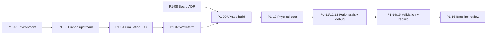

# Phase 1 — baseline Ibex trên FPGA

Mục tiêu: dựng và hiểu baseline SoC, chạy firmware C, kiểm tra ngoại vi/debug, tái dựng và báo cáo giới hạn. Kế hoạch 8 tuần, 2026-10-21–2026-12-15; có thể rút/giãn trong khoảng 6–8 tuần theo điều kiện thực tế. Không cam kết hoàn tất khi board/tool chưa có. Trạng thái công việc chỉ đọc từ [backlog](backlog.md).

## Work packages và Definition of Done

| WP | Task | Deliverable | Definition of Done (DoD) |
| --- | --- | --- | --- |
| WP1 — platform research | P1-01 | So sánh core/reference system, shortlist board, tiêu chí và rủi ro | Trích nguồn chính thức; phân biệt supported/experimental, nguồn điện/kết nối/công cụ; chưa tuyên bố Ibex tối ưu |
| WP1 — platform research | P1-02 | Bản ghi môi trường | Lệnh doctor/Vivado check chạy thật; ghi detected/tested/unknown và user-available riêng; có hướng dẫn local cho tool không truy cập được |
| WP1 — platform research | P1-03 | Checkout upstream khớp immutable pin | URL/SHA/license xác minh từ tree; dependency strategy tái lập; không đưa vendor/build vào source riêng |
| WP1 — platform research | P1-08 | ADR board | Người dùng xác nhận board; exact part, upstream target, constraints, clock/reset, interface, quyền truy cập tool được ghi từ nguồn |
| WP2 — architecture learning | P1-05 | Bài giải CA01–CA02 và sơ đồ core/SoC | Người học giải thích được lệnh mẫu, ISA khác microarchitecture, đánh dấu cấu hình đã đọc và câu hỏi mở |
| WP2 — architecture learning | P1-06 | Memory map và trace RTL → firmware | Mỗi địa chỉ/offset có nguồn ở SHA pin; ghi width/access/reset/side effect; đối chiếu decoder, linker và header |
| WP3 — RTL sim/firmware | P1-04 | Upstream simulator và demo C | Có exact command, versions/SHA, exit status và output mong đợi; ghi separately build vs firmware execution |
| WP3 — RTL sim/firmware | P1-07 | Trace load/store/branch | Waveform/run metadata tái lập; giải thích request/grant/response và ít nhất một stall; raw trace không commit |
| WP4 — FPGA bring-up | P1-09 | Synthesis, implementation, timing, bitstream | Mỗi bước có trạng thái riêng; constraints đúng board; reports không có vi phạm chưa giải thích; artifact checksum gắn revision |
| WP4 — FPGA bring-up | P1-10 | Physical boot report | Board/bitstream/firmware/tool versions, reset/power procedure và log quan sát được ghi; tái chạy boot thành công |
| WP5 — peripherals/debug | P1-11 | GPIO/UART/CLI firmware và test | GPIO input/output; UART tx/rx với expected/actual; timeout/error path rõ, log thuộc board thật |
| WP5 — peripherals/debug | P1-12 | Timer/interrupt test | Kích hoạt, vào handler, clear/rearm, xử lý lặp được quan sát; timeout và trap ngoài dự kiến được kiểm tra |
| WP5 — peripherals/debug | P1-13 | Debug session | OpenOCD kết nối, GDB halt/step/breakpoint, inspect register/memory; ghi transport và exact config |
| WP6 — validation/characterization | P1-14 | Repeated tests và counter protocol | Xác định đoạn đo, overhead, đơn vị, số lần lặp trước khi đo; lưu kết quả thất bại và phân tán |
| WP6 — validation/characterization | P1-15 | Rebuild và resource/timing summary | Rebuild từ revision sạch với pin/tool/config ghi đủ; số liệu lấy từ report, phân biệt target frequency và achieved timing |
| WP6 — validation/characterization | P1-16 | Baseline v1 review | Verification matrix có evidence; limitations; hướng dẫn tái dựng; tag local chỉ sau khi gate được review |

## Lịch W1–W8

| Tuần | Khoảng ngày (bao gồm hai đầu) | Kỹ thuật và task | Học song song | Gate tuần |
| --- | --- | --- | --- | --- |
| W1 | 2026-10-21–2026-10-27 | P0-01, P1-01/02/03; thử chuẩn bị P1-04 | CA01: ISA RV32I/M/C, core vs SoC, fetch/decode/execute | Workspace/check thực chạy, env inventory, pin strategy; blockers rõ |
| W2 | 2026-10-28–2026-11-03 | P1-04/05; build upstream và C dưới Verilator | CA02: register file, datapath, assembler/linker | Simulator build + firmware output có log |
| W3 | 2026-11-04–2026-11-10 | P1-06/07/08; memory map, waveform, board ADR | CA03: pipeline, hazards, interfaces | Truy được register; board xác nhận trước FPGA build |
| W4 | 2026-11-11–2026-11-17 | P1-09/10; Vivado và physical boot | CA04: FPGA mapping, constraints, timing | Reports và bitstream riêng; boot board có quan sát |
| W5 | 2026-11-18–2026-11-24 | P1-11; GPIO/UART/CLI nhỏ | CA05: MMIO, bus transactions, registers | GPIO in/out và UART tx/rx có expected/actual |
| W6 | 2026-11-25–2026-12-01 | P1-12/13; timer/interrupt, OpenOCD/GDB | CA06: traps, CSRs, debug | Interrupt test và debug session tái lập |
| W7 | 2026-12-02–2026-12-08 | P1-14/15; kiểm tra lặp, counters, reports | CA07: CPI, cycle count, profiling | Report có điều kiện đo, đơn vị, variability |
| W8 | 2026-12-09–2026-12-15 | P1-15/16; rebuild/review/baseline v1 | CA08: tổng hợp kiến trúc và evidence | Baseline tái dựng và limitations được review |

Vivado availability/version phải kiểm tra từ W1 khi runtime cho phép, không chờ W4. Mốc tuần không tự đổi trạng thái. Nếu board chậm, W4–W6 phần hardware giữ BLOCKED; ưu tiên pin, simulator, học và chuẩn bị test protocol.

## Phụ thuộc và ranh giới bằng chứng

Mọi run phải có ngày, task ID, upstream/workspace/firmware revision, lệnh, cấu hình, environment, expected/actual, trạng thái và đường dẫn log. Simulation PASS không thay hardware PASS; bitstream tạo được không thay timing closure hoặc boot. Không ghi dữ liệu license/machine ID vào báo cáo.
